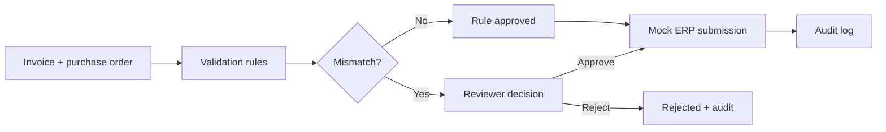

# ProofFlow AI

**Evidence-first invoice verification · Human approval · Auditable mock ERP workflow**

[](https://github.com/themaden/ProofFlow-AI/actions/workflows/ci.yml)

> **Scope:** Demonstration software with synthetic records and a fake ERP. Not a banking product, not a real payment processor, and not a deployed LLM agent.

## Why it exists
Review teams need to understand **why** an invoice and a purchase order differ before approval. ProofFlow applies deterministic checks, records evidence, enforces separate operator/reviewer access, and writes an audit trail. It demonstrates backend and ML experimentation without pretending the synthetic research is production-grade AI.

### Workflow


## Engineering highlights
- **API:** typed request/response validation, explicit HTTP errors, role-based route protection.
- **State & storage:** idempotent invoice ID, SQLite persistence, case audit events, mock submission gate.
- **Research:** four Jupyter notebooks, deterministic synthetic training and evaluation; model does **not** decide approvals.
- **Quality:** automated pytest suite in GitHub Actions, Dockerfile, limitations and threat-model notes.


A **working local portfolio MVP**, built to demonstrate Python backend engineering, financial data validation, reproducible ML research, permission checks, auditing and a usable review UI. It **does not execute real payments**, connect to an ERP, or claim compliance with banking standards.

## Features (implemented)
- FastAPI REST endpoints, typed input schemas and rule-by-rule evidence
- Idempotent invoice ingestion; an invoice ID reused with changed content returns HTTP 409
- SQLite persistent cases and immutable *application-level* audit event rows
- Separate operator and reviewer API keys; approval/rejection requires reviewer role
- Review gate before mock ERP submission; repeated submissions do not duplicate events
- Local `/demo` browser console to create, inspect, approve/reject and mock-submit cases
- Four Jupyter research notebooks: EDA, training, evaluation and error analysis
- Deterministic synthetic ML benchmark command (not involved in payment decisions)
- Pytest, GitHub Actions and Dockerfile

## Run locally
Requires Python 3.10+.

```bash
python -m venv .venv
# Windows PowerShell: .venv\\Scripts\\Activate.ps1
# macOS/Linux: source .venv/bin/activate
pip install -e '.[dev,notebooks]'
# set environment variables before starting the service
export PROOFFLOW_OPERATOR_KEY="$(python -c 'import secrets; print(secrets.token_urlsafe(32))')"
export PROOFFLOW_REVIEWER_KEY="$(python -c 'import secrets; print(secrets.token_urlsafe(32))')"
export PROOFFLOW_DB='proofflow.db'
uvicorn proofflow.api:app --reload
```

Windows PowerShell equivalents:

```powershell
$env:PROOFFLOW_OPERATOR_KEY = python -c "import secrets; print(secrets.token_urlsafe(32))"
$env:PROOFFLOW_REVIEWER_KEY = python -c "import secrets; print(secrets.token_urlsafe(32))"
$env:PROOFFLOW_DB = 'proofflow.db'
uvicorn proofflow.api:app --reload
```

Open **http://127.0.0.1:8000/demo**. Enter the operator and reviewer keys in the page, create an example case, review its rules and history, then approve it with the reviewer key before submitting to the mock ERP with the operator key. `http://127.0.0.1:8000/docs` contains interactive API documentation.

## Tests and research
```bash
pytest -q
python -m proofflow.benchmark --out artifacts/benchmark.json
jupyter lab
```

**Critical evaluation caveat:** The synthetic dataset's label is largely a direct function of `amount_gap`, a feature supplied to the model. Therefore an AUC near 1.0 represents an intentionally learnable synthetic target, **not financial-model generalization or a deployable fraud detector**. The model is not used by the workflow. Real evaluation requires independent data, leakage checks, time-aware splits, calibration and human validation.

## API endpoints
`GET /health` public health check, `POST /cases` operator, `GET /cases` authenticated, `GET /cases/{id}` authenticated, `GET /cases/{id}/audit` authenticated, `POST /cases/{id}/decision` reviewer, and `POST /cases/{id}/submit` operator.

Mutating requests must pass `x-api-key` headers. `/demo` is intended only for local development. Audit actor is derived from authenticated *role*, not the supplied actor text.

## Limitations / non-goals
This is **not production-ready**: API keys are demo-only static secrets; no OIDC, tenancy, rate limiting, TLS termination, migrations, distributed locking, durable outbox, OCR, actual LLM integration, real ERP, or bank data. SQLite works for a single local instance; parallel deployments require a transactional server DB and suitable concurrency controls. The UI is intentionally unbundled and contains no paid components. Do not put real business documents or production credentials in this demo.

See [architecture](docs/architecture.md), [security](docs/security.md), [licenses](THIRD_PARTY_LICENSES.md) and the [roadmap](docs/roadmap.md).

## Security and secret management
- Never commit a `.env`, API key, customer invoice or local SQLite database. `.gitignore` excludes these by default.
- Generate **two different** high-entropy API keys, as shown above. Empty or short (<16 character) secrets cannot authenticate.
- The demo uses static role keys (not actual user identity). Do not expose this service on the public internet.
- Rotate credentials if you suspect disclosure; `.env.example` contains placeholders only.
- Use OIDC, HTTPS, rate limits, authorization-per-resource and managed secrets before production.

## Repository structure
```text
.github/workflows/ci.yml   CI tests
src/proofflow/            API, verification, service, persistence and auth
src/proofflow/static/     Local browser review console
tests/                    Regression and API tests
notebooks/                Synthetic ML experiments
docs/                     Architecture, security and roadmap
examples/                 Sample request payload
```
