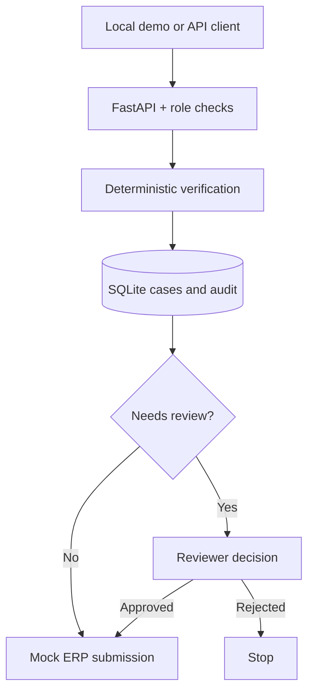

# Architecture and design decisions

1. A typed CaseInput is received by FastAPI. Operator authentication is checked before mutation.
2. `verify()` evaluates supplier, PO number, currency and exact `Decimal` amount equality; it returns recorded evidence.
3. The workflow marks cases `approved_by_rules` when all checks pass, else `needs_review`.
4. `CaseService` writes the case and an audit entry into a local SQLite database. Case identifiers are UUIDs; invoice IDs are unique and idempotent for identical payloads.
5. Only the reviewer role can decide a `needs_review` case. Rejection is terminal. Only approved cases can be submitted to a **mock** ERP, and submission repeats are idempotent.
6. The `/demo` single-page UI consumes these APIs. The example ML workflow is deliberately separate from deterministic approval.

## Tradeoffs
SQLite is the minimum persistent store for a single-process demo, rather than a claim of resilient, clustered production deployment. The static API-key implementation is a deliberately narrow demonstration of RBAC enforcement; enterprise deployments require short-lived OIDC tokens with scopes and tenant isolation. Strict amount equality is the documented current business rule; tolerances, tax, line-item validation and partial deliveries must be defined by a domain owner before real use.
